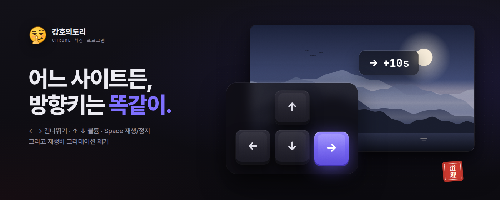
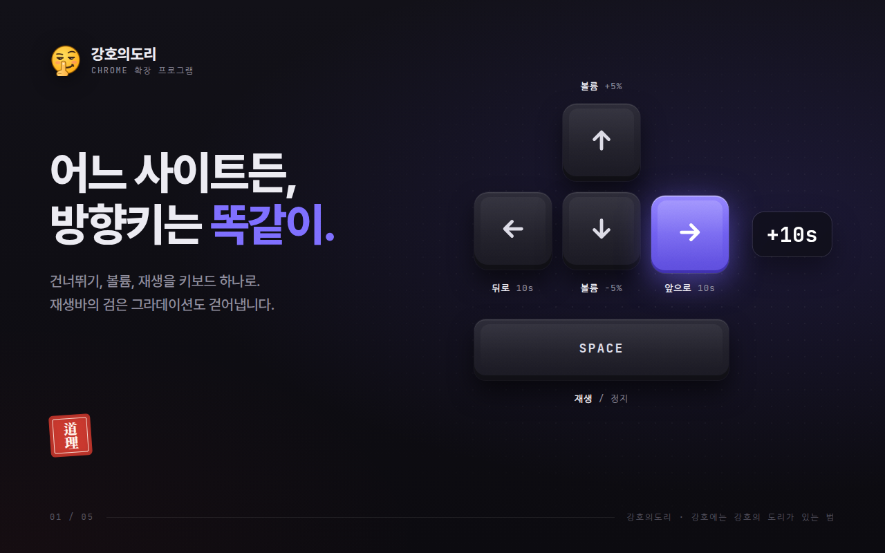
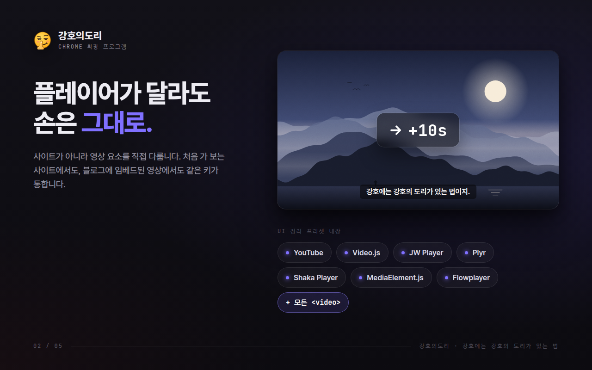
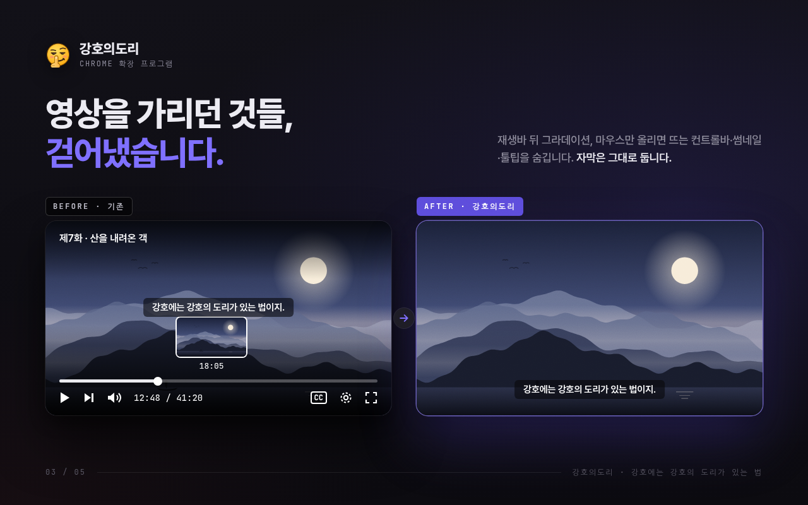
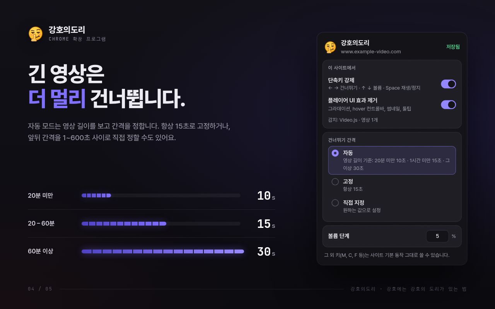
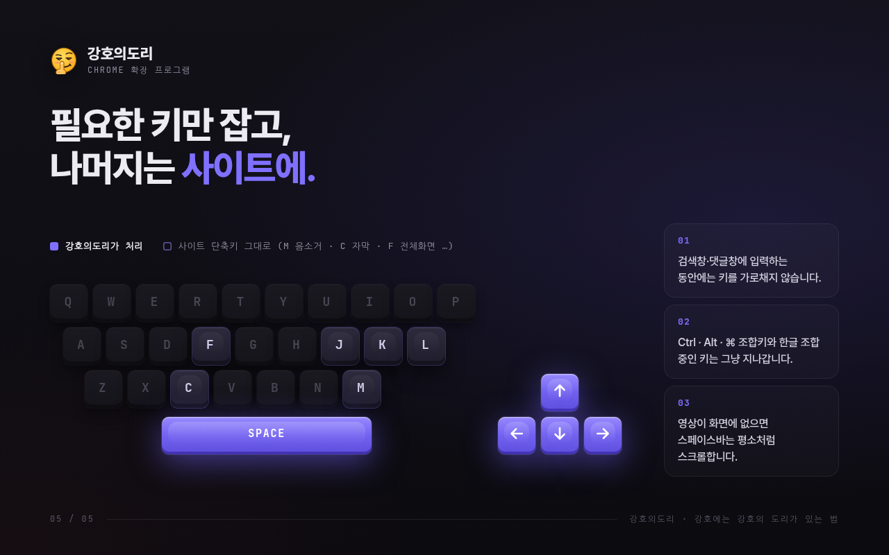

<div align="center">


# 강호의도리 · BroCode

**어느 동영상 사이트든, 방향키는 똑같이.**

방향키로 건너뛰기, 위아래로 볼륨, 스페이스바로 재생/정지.<br>
재생바 뒤 검은 그라데이션과 hover 컨트롤바도 걷어내는 Chrome 확장 프로그램입니다.


[English summary](#english) · [설치](#설치) · [개발](#개발)

</div>



## 왜 만들었나

→ 키를 누르면 어떤 사이트는 5초, 어떤 사이트는 10초를 건너뜁니다. 재생바를 한 번 클릭해야 키가 먹는 곳도 있고, 단축키가 아예 없는 곳도 있습니다.
여기에 재생바 뒤 검은 그라데이션, 마우스만 움직이면 튀어나오는 컨트롤바와 썸네일이 화면을 가립니다.

강호의도리는 사이트마다 다른 이 규칙을 하나로 맞춥니다.

## 기능

### 1. 어디서나 같은 단축키



| 키 | 동작 |
|---|---|
| `→` / `←` | 앞으로 / 뒤로 건너뛰기 (누르고 있으면 계속 이동) |
| `↑` / `↓` | 볼륨 5%씩 올리기 / 내리기 (음소거 상태면 ↑로 해제) |
| `Space` | 재생 / 일시정지 |

- 영상 화면, 재생바, 페이지 빈 곳 중 어디를 클릭했든 똑같이 동작합니다.
- 키를 누르면 영상 위에 `+10s`, `볼륨 40%`, `⏸` 같은 표시가 잠깐 뜹니다. 전체화면에서도 보입니다.
- 한 페이지에 영상이 여러 개면 마지막으로 마우스를 올린 영상, 재생 중인 영상, 가장 크게 보이는 영상 순서로 대상을 고릅니다.

### 2. 처음 보는 사이트에서도 동작



사이트별 코드가 아니라 표준 `<video>` 요소를 직접 다룹니다.

- 일반 페이지는 물론 shadow DOM과 iframe 안의 영상까지 찾습니다.
- 다른 도메인에서 임베드한 영상(블로그 속 YouTube 등)도 조작할 수 있습니다.
- 페이지가 로드되는 시점에 키 입력을 먼저 받아서, 사이트 스크립트가 키를 가로채기 전에 처리합니다.

### 3. 영상을 가리는 UI 걷어내기



- **숨기는 것**: 재생바 뒤 검은 그라데이션과 반투명 배경, hover 시 나타나는 컨트롤바·미리보기 썸네일·툴팁
- **그대로 두는 것**: 자막, 영상에 원래 들어 있는 레터박스
- 세 단계로 적용합니다.
  1. **모든 사이트 공통**: 기본 컨트롤 배경, 영상 위 그라데이션 제거
  2. **플레이어 종류별 프리셋**: YouTube, Video.js, JW Player, Plyr, Shaka Player, MediaElement.js, Flowplayer. 페이지 구조로 플레이어를 알아보기 때문에, 같은 플레이어를 쓰는 처음 보는 사이트에도 자동으로 적용됩니다.
  3. **사이트별 설정**: 특정 사이트에만 규칙을 더하거나 뺍니다.

> 컨트롤바를 숨기면 마우스로 누르던 버튼도 함께 사라집니다. 버튼이 필요한 사이트에서는 팝업에서 UI 정리만 끄면 됩니다.

### 4. 영상 길이에 맞는 건너뛰기 간격



| 모드 | 규칙 |
|---|---|
| **자동** (기본) | 20분 미만 10초 · 1시간 미만 15초 · 1시간 이상 30초 · 라이브 10초 |
| **고정** | 앞/뒤 항상 15초 |
| **직접 지정** | 앞/뒤를 따로, 1~600초 |

볼륨 단계(기본 5%)도 1~25% 사이에서 바꿀 수 있습니다. 설정은 바꾸는 즉시 반영되고 Chrome 동기화 저장소에 저장됩니다.

### 5. 사이트 단축키는 건드리지 않음



- `←` `→` `↑` `↓` `Space` 다섯 개만 처리합니다. `M` 음소거, `C` 자막, `F` 전체화면 같은 키는 사이트 동작 그대로입니다.
- 검색창이나 댓글창에 입력 중일 때, 한글 조합 중일 때, `Ctrl` · `Alt` · `⌘` 조합키는 가로채지 않습니다.
- 화면에 영상이 없으면 스페이스바는 평소처럼 페이지를 스크롤합니다.
- 사이트가 재생 위치를 강제로 되돌리면 "이 플레이어가 이동을 막고 있음"이라고 알려 줍니다.

## 설치

Chrome 웹 스토어 등록을 준비 중입니다. 그 전까지는 개발자 모드로 설치할 수 있습니다.

1. 이 레포를 내려받습니다. (`git clone https://github.com/P2P-J/BroCode.git`)
2. Chrome에서 `chrome://extensions`를 열고 오른쪽 위 **개발자 모드**를 켭니다.
3. **압축해제된 확장 프로그램을 로드합니다**를 누르고 내려받은 폴더를 선택합니다.

새로 방문하는 사이트는 단축키와 UI 정리가 모두 켜진 상태로 시작합니다. 툴바 아이콘을 누르면 사이트별로 끄고 켤 수 있습니다.

## 한계

- DRM이 걸린 영상(Netflix 등)이나 서버가 데이터를 주지 않는 구간은 이동이 제한될 수 있습니다.
- 영상이 없는 다른 도메인 영역(외부 댓글창 iframe 등)에 키보드 입력이 들어가 있으면 키를 받지 못할 수 있습니다.
- `chrome://` 페이지처럼 확장이 실행될 수 없는 곳에서는 동작하지 않습니다.
- 광고 차단과 영상 다운로드 기능은 없습니다.

## 개인정보

필요한 권한은 설정 저장용 `storage`와 모든 사이트의 영상에 접근하기 위한 호스트 권한뿐입니다. 설정은 Chrome 동기화 저장소에만 저장되고, 외부 서버로 보내는 데이터는 없습니다.

## 개발

프레임워크와 빌드 도구 없이 바닐라 JavaScript(ES2022)로 작성했습니다.

```bash
npm install
npm test           # 단위 테스트 (node:test)
npm run test:e2e   # Chromium에 확장을 올려 test/fixtures 페이지로 E2E 테스트
npm run icons      # 아이콘 다시 생성
```

E2E는 `~/.cache/ms-playwright/chromium-1226`의 Chromium을 씁니다. 다른 경로를 쓰려면 `BROCODE_CHROME=/path/to/chrome`을 지정하세요.

### 구조

```
Popup ──설정──▶ chrome.storage ◀──구독── 모든 Content Script
                     │
Service Worker: 기본값 · 프레임별 영상 현황 · 키 전달
                     │
Content Script (모든 프레임)
  ├ 단축키 엔진: 키 가로채기 → 대상 영상 선택 → 컨트롤러 → OSD
  └ UI 정리: 플레이어 감지 → 프리셋/사이트 규칙 적용
                     │ (선택)
Main-world 어댑터: YouTube처럼 자체 상태를 가진 플레이어와 동기화
```

```
src/
├─ background/      서비스 워커
├─ content/
│  ├─ config/       players.js (플레이어 프리셋) · sites.js (사이트별 설정)
│  ├─ core/         키 판정, 영상 탐색, 컨트롤러, OSD, iframe 연결
│  └─ features/     hotkeys.js · ui-clean.js
├─ main-world/      youtube.js 어댑터
└─ shared/          기본값, 설정, 간격 계산, 호스트 매칭
popup/              설정 팝업
_locales/           en · ko
store-assets/       웹 스토어 이미지와 등록 문구
```

### 어디를 고치면 되나

| 하고 싶은 것 | 파일 |
|---|---|
| 플레이어 프리셋(숨길 선택자) 추가·수정 | `src/content/config/players.js` |
| 특정 사이트만 규칙 바꾸기 | `src/content/config/sites.js` |
| 건너뛰기 간격표, 기본값 | `src/shared/defaults.js` |
| 스토어 이미지 문구 | `store-assets/src/promo.html` 수정 후 `node store-assets/src/render.js` |

전체 기획은 [docs/PLANNING.md](docs/PLANNING.md)에 있습니다.

---

## English

**BroCode** is a Chrome extension (Manifest V3) that gives every HTML5 video player the same keys:

- `→` / `←` skip forward / back (auto interval by video length: 10s, 15s or 30s; or fixed 15s; or custom 1–600s)
- `↑` / `↓` volume ±5%
- `Space` play / pause

It also removes the dark gradient behind the seek bar and the controls, thumbnails and tooltips that pop up on hover, while leaving subtitles alone. Presets cover YouTube, Video.js, JW Player, Plyr, Shaka Player, MediaElement.js and Flowplayer, and it works inside shadow DOM and cross-origin iframes. Site shortcuts such as `M`, `C` and `F` keep working, and nothing is intercepted while you type.

UI is available in English and Korean. English store images live in [`store-assets/en`](store-assets/en).

Install: open `chrome://extensions`, enable **Developer mode**, click **Load unpacked**, and select this folder.
