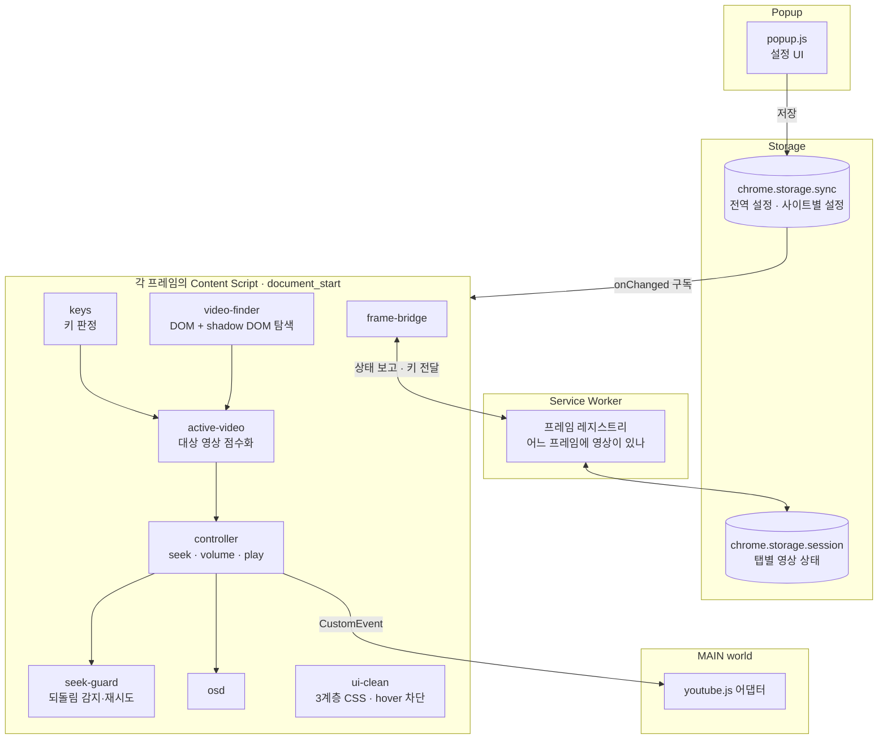
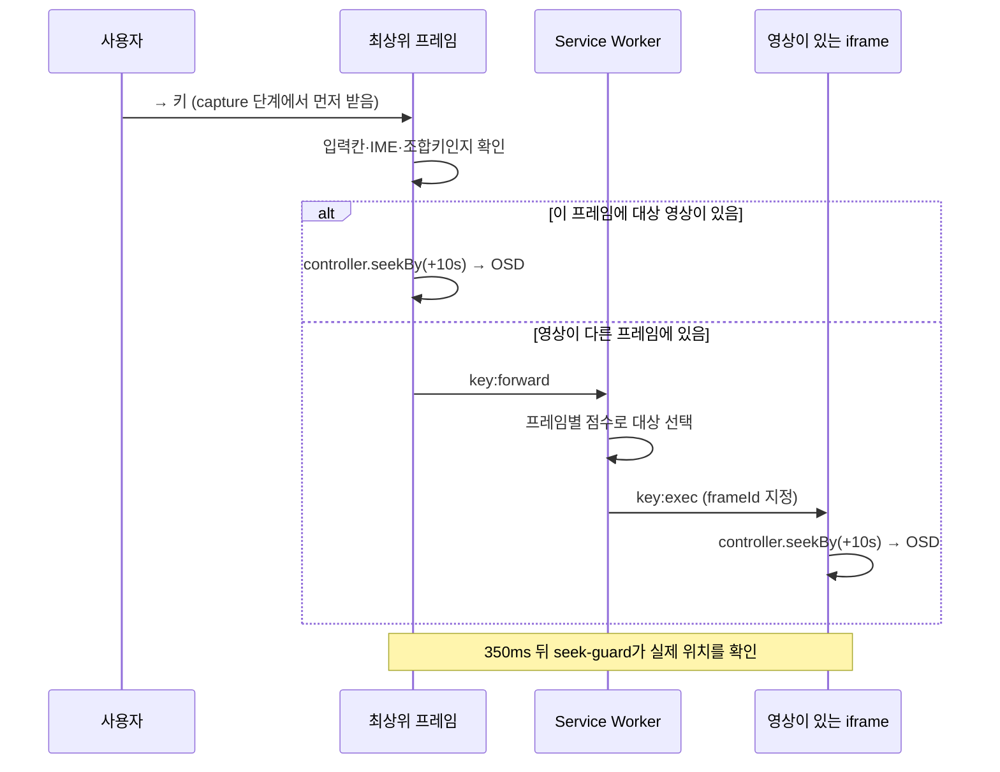

<div align="center">


# 강호의도리 · BroCode

**어느 동영상 사이트든, 방향키는 똑같이.**<br>
<sub>Same keys. Every video site.</sub>

방향키로 건너뛰기, 위아래로 볼륨, 스페이스바로 재생/정지.<br>
재생바 뒤 검은 그라데이션과 hover 컨트롤바도 걷어내는 Chrome 확장 프로그램입니다.


[기능](#기능) · [설치](#설치) · [아키텍처](#아키텍처) · [설계 결정](#설계-결정과-트레이드오프) · [테스트](#테스트-전략) · [개인정보](#개인정보와-권한) · [English](#english)

</div>


## 문제

웹 동영상 플레이어는 키보드 동작이 제각각입니다.

| 증상 | 사용자가 겪는 일 |
|---|---|
| 건너뛰기 간격이 다름 | 어떤 사이트는 → 가 5초, 어떤 사이트는 10초 |
| 포커스 조건이 있음 | 재생바를 한 번 클릭해야 키가 먹고, 영상 화면을 클릭하면 안 먹음 |
| 단축키가 없거나 막혀 있음 | 키를 눌러도 아무 일도 없거나, 사이트가 이동을 되돌림 |
| UI가 화면을 가림 | 재생바 뒤 검은 그라데이션, 마우스만 움직여도 뜨는 컨트롤바·썸네일·툴팁 |

강호의도리의 목표는 하나입니다. **어느 플레이어에서든 같은 키가 같은 동작을 하게 만들고, 그 과정에서 사이트가 원래 가진 기능은 망가뜨리지 않는 것.**

## 기능

### 1. 어디서나 같은 단축키


| 키 | 동작 |
|---|---|
| `→` / `←` | 앞으로 / 뒤로 건너뛰기 (누르고 있으면 계속 이동) |
| `↑` / `↓` | 볼륨 5%씩 조절 (음소거 상태에서 `↑`를 누르면 해제) |
| `Space` | 재생 / 일시정지 |

영상 화면, 재생바, 페이지 빈 곳 중 어디를 클릭했든 똑같이 동작합니다. 키를 누르면 영상 위에 `+10s`, `볼륨 40%` 같은 표시(OSD)가 잠깐 뜨고, 전체화면에서도 보입니다.

### 2. 처음 보는 사이트에서도 동작


사이트별 코드가 아니라 표준 `<video>` 요소를 직접 다룹니다. shadow DOM 안의 영상, 다른 도메인에서 임베드한 iframe 속 영상도 찾아서 조작합니다.

### 3. 영상을 가리는 UI 걷어내기


재생바 뒤 그라데이션, hover 컨트롤바, 미리보기 썸네일, 툴팁을 숨깁니다. **자막과 레터박스는 건드리지 않습니다.** YouTube, Video.js, JW Player, Plyr, Shaka Player, MediaElement.js, Flowplayer는 플레이어 구조를 보고 맞춤 규칙을 적용합니다.

### 4. 영상 길이에 맞는 건너뛰기 간격


| 모드 | 규칙 |
|---|---|
| **자동** (기본) | 20분 미만 10초 · 1시간 미만 15초 · 1시간 이상 30초 · 라이브 10초 |
| **고정** | 앞/뒤 항상 15초 |
| **직접 지정** | 앞/뒤를 따로, 1~600초 |

볼륨 단계는 1~25% 사이에서 바꿀 수 있습니다. 설정은 즉시 반영되고 Chrome 동기화 저장소에 저장됩니다.

### 5. 사이트 단축키는 건드리지 않음


`←` `→` `↑` `↓` `Space` 다섯 개만 처리합니다. `M` 음소거, `C` 자막, `F` 전체화면 같은 키는 사이트 동작 그대로입니다. 입력칸에 글을 쓰는 중이거나, 한글을 조합 중이거나, `Ctrl` · `Alt` · `⌘` 조합키를 누를 때는 개입하지 않습니다. 화면에 영상이 없으면 스페이스바는 평소처럼 스크롤합니다.

## 설치

> Chrome 웹 스토어 등록을 준비 중입니다. 그 전까지는 개발자 모드로 설치할 수 있습니다.

1. 레포를 내려받습니다: `git clone https://github.com/P2P-J/BroCode.git`
2. Chrome에서 `chrome://extensions`를 열고 오른쪽 위 **개발자 모드**를 켭니다.
3. **압축해제된 확장 프로그램을 로드합니다**를 누르고 내려받은 폴더를 선택합니다.

새 사이트는 두 기능이 모두 켜진 상태로 시작합니다. 툴바 아이콘을 눌러 사이트별로 끄고 켤 수 있습니다.

---

## 아키텍처

런타임 의존성 0개, 빌드 단계 없는 바닐라 JavaScript(ES2022)입니다. 확장 코드는 약 1,300줄입니다.



### 키 하나가 처리되는 과정



| 모듈 | 책임 |
|---|---|
| `src/content/core/keys.js` | 키 → 명령 변환. 수정키, IME 조합, 편집 가능한 요소 걸러내기 |
| `src/content/core/video-finder.js` | `TreeWalker`로 문서와 shadow DOM(닫힌 것 포함)의 `<video>` 수집. 1.5초 캐시 |
| `src/content/core/active-video.js` | 여러 영상 중 조작 대상을 점수로 선택 |
| `src/content/core/controller.js` | 네이티브 `<video>` 조작과 플레이어 어댑터 호출 |
| `src/content/core/seek-guard.js` | 사이트의 이동 되돌림 감지, 1회 재시도, 실패 알림 |
| `src/content/core/frame-bridge.js` | 프레임 상태 보고(300ms 디바운스), 다른 프레임으로 키 전달 |
| `src/content/core/watch.js` | `MutationObserver` 변경을 400ms 단위로 묶어 재검사 |
| `src/content/features/ui-clean.js` | 플레이어 감지, CSS 주입, hover 이벤트 차단, `controls` 속성 제거 |
| `src/main-world/youtube.js` | YouTube 플레이어 API로 볼륨을 바꿔 플레이어 UI와 값 동기화 |
| `src/content/config/` | 플레이어 프리셋과 사이트별 규칙 (코드가 아닌 데이터) |

## 설계 결정과 트레이드오프

### 1. 사이트가 아니라 `<video>` 요소를 직접 제어

사이트별 스크립트를 쓰면 지원 목록이 곧 한계가 됩니다. 표준 `HTMLMediaElement`의 `currentTime`, `volume`, `play()`를 직접 다루면 처음 보는 사이트에서도 동작합니다.
**대가:** 자체 상태를 가진 플레이어(YouTube)는 네이티브 볼륨만 바꾸면 플레이어 UI의 볼륨바와 값이 어긋납니다. 이런 플레이어만 MAIN world 어댑터로 플레이어 API를 호출하고, 어댑터가 200ms 안에 응답하지 않으면 네이티브 제어로 돌아갑니다.

### 2. `document_start` + capture 리스너로 키를 먼저 받음

사이트가 키를 먹어 버리거나 포커스 조건을 거는 문제는 이벤트 순서 문제입니다. 페이지 스크립트보다 먼저 capture 단계에서 키를 받아 처리하고, 처리한 키만 전파를 막습니다.
**대가:** 키를 가로채는 범위를 최소화해야 합니다. 그래서 다섯 개 키만 다루고, 입력칸, IME 조합(`isComposing`, `keyCode 229`), 수정키 조합은 판정 단계에서 바로 통과시킵니다.

### 3. 대상 영상은 점수로 선택

한 페이지에 미리보기 영상, 광고, 본편이 함께 있을 수 있습니다. 규칙을 나열하는 대신 점수를 더합니다.

```
score = 화면에 보이는 비율 × 10
      + 재생 중이면 20
      + 마지막 마우스 위치가 영상 위면 30
      + 전체화면이면 50
```

"마지막으로 마우스를 올린 영상 > 재생 중인 영상 > 크게 보이는 영상"이라는 기획 우선순위를 가중치로 표현했습니다. 프레임 사이에서도 같은 점수를 비교해 서비스 워커가 키를 보낼 프레임을 고릅니다.

### 4. 이동을 막는 플레이어는 감지하고, 한 번만 맞섬

일부 플레이어는 `seeking` 이벤트에서 위치를 되돌립니다. 이동 350ms 뒤 실제 위치를 확인해서(허용 오차 1.5초 + 재생 진행분), 되돌려졌다면 해당 영상을 보호 대상으로 표시하고 700ms 동안 사이트의 `seeking`/`seeked` 리스너를 capture 단계에서 막은 채 한 번 재시도합니다. 그래도 실패하면 억지로 싸우지 않고 "이 플레이어가 이동을 막고 있음"을 표시합니다.
**왜 한 번만:** 무한 재시도는 사이트와 경쟁 상태를 만들고 재생을 망가뜨립니다. 사용자에게 상황을 알리는 편이 낫습니다.

### 5. UI 정리는 3계층, 선택자는 데이터로

| 계층 | 적용 범위 | 예 |
|---|---|---|
| 공통 | 모든 사이트 | 네이티브 컨트롤 배경, 영상 위 그라데이션 |
| 플레이어 프리셋 | 페이지 구조로 감지된 플레이어 | Video.js, JW Player 등 7종 |
| 사이트 오버라이드 | 특정 호스트 | 규칙 추가·제외 |

플레이어 클래스명은 사이트 업데이트로 자주 바뀝니다. 선택자를 `config/` 데이터 파일에 두어, 바뀌면 코드 수정 없이 그 파일만 고치도록 했습니다.

### 6. 빌드 도구와 의존성 없음

확장 크기와 심사 부담을 줄이고, 스토어에 올라간 코드와 이 레포의 코드가 1:1로 같도록 했습니다. 모듈은 `globalThis.BRO` 네임스페이스와 manifest의 로드 순서로 연결합니다.
**대가:** 모듈 간 의존이 로드 순서에 묶입니다. 순서는 `manifest.json`의 `content_scripts.js` 배열 한 곳에서만 관리합니다.

## 테스트 전략

| 층 | 도구 | 범위 | 개수 |
|---|---|---|---|
| 단위 | `node:test` | 설정 정규화, 간격 계산, 호스트 매칭, 키 판정 | 21 |
| E2E | Playwright + 실제 Chromium에 확장 로드 | 단축키, 팝업, UI 정리 | 16 |

E2E는 실제 사이트 대신 재현용 테스트 페이지(`test/fixtures`)를 로컬 서버로 띄워 검증합니다. 외부 사이트 변화에 테스트가 흔들리지 않게 하려는 선택입니다.

| 테스트 페이지 | 재현하는 상황 |
|---|---|
| `basic.html` | 일반 `<video>` |
| `focusbar.html` | 재생바에 포커스가 있어야만 키가 동작하는 플레이어 |
| `antiskip.html` | 본 적 없는 구간으로 이동하면 위치를 되돌리는 플레이어 |
| `shadow.html` | shadow DOM 안에 숨은 영상 |
| `iframe-parent.html` | 다른 도메인 iframe 속 영상 |
| `presets.html` | 플레이어 프리셋 감지와 UI 정리 |

```bash
npm install
npm test           # 단위 테스트
npm run test:e2e   # E2E (Chromium: ~/.cache/ms-playwright/chromium-1226, 또는 BROCODE_CHROME=/path/to/chrome)
npm run icons      # 아이콘 다시 생성
```

## 개인정보와 권한

**수집하는 데이터: 없음.** 외부 서버와 통신하지 않고, 원격 코드를 불러오지 않으며, 분석·광고 코드가 없습니다. 전문은 [개인정보처리방침](https://p2p-j.github.io/BroCode/privacy.html)에 있습니다.

| 권한 | 이유 |
|---|---|
| `storage` | 전역 설정과 사이트별 켜짐/꺼짐 저장 |
| `<all_urls>` | 사용자가 영상을 보는 어느 사이트에서든 `<video>`와 플레이어 UI에 접근 |

| 저장소 | 내용 | 수명 |
|---|---|---|
| `chrome.storage.sync` | 간격 모드, 직접 지정 초, 볼륨 단계, 사용자가 스위치를 바꾼 사이트의 호스트 이름 | 확장 삭제 시까지 |
| `chrome.storage.session` | 탭별 영상 개수·재생 여부·감지된 플레이어 종류 (URL 없음) | 탭·브라우저 종료 시 삭제 |

## 한계

- DRM 영상(Netflix 등)이나 서버가 데이터를 주지 않는 구간은 이동이 제한될 수 있습니다.
- 영상이 없는 다른 도메인 iframe(외부 댓글창 등)에 키보드 포커스가 있으면 키를 받지 못할 수 있습니다.
- `chrome://` 페이지처럼 확장이 실행될 수 없는 곳에서는 동작하지 않습니다.
- 광고 차단과 영상 다운로드는 범위 밖입니다.

## 프로젝트 구조

```
├─ manifest.json        MV3 매니페스트 (content script 로드 순서가 곧 모듈 의존 순서)
├─ src/
│  ├─ background/       서비스 워커: 프레임 레지스트리, 키 라우팅
│  ├─ content/
│  │  ├─ config/        players.js (프리셋) · sites.js (사이트별 규칙)
│  │  ├─ core/          keys · video-finder · active-video · controller · seek-guard · osd · frame-bridge · watch
│  │  └─ features/      hotkeys · ui-clean
│  ├─ main-world/       youtube.js 어댑터
│  └─ shared/           defaults · settings · step · host
├─ popup/               설정 팝업
├─ _locales/            en · ko
├─ test/                unit · e2e · fixtures
├─ docs/                기획서, 개인정보처리방침 (GitHub Pages)
└─ store-assets/        웹 스토어 이미지·등록 문구, 렌더 스크립트
```

| 하고 싶은 것 | 파일 |
|---|---|
| 플레이어 프리셋 추가·수정 | `src/content/config/players.js` |
| 특정 사이트 규칙 | `src/content/config/sites.js` |
| 간격표, 기본값 | `src/shared/defaults.js` |
| 스토어 이미지 문구 | `store-assets/src/promo.html` 수정 후 `node store-assets/src/render.js` |

전체 기획과 결정 기록은 [docs/PLANNING.md](docs/PLANNING.md)에 있습니다.

## 로드맵

- [x] v0.1.0: 단축키 엔진, OSD, 3계층 UI 정리, iframe 키 전달, 이동 되돌림 대응, en/ko
- [ ] Chrome 웹 스토어 출시
- [ ] 실제 사이트 점검 결과를 바탕으로 플레이어 프리셋 보강
- [ ] 사이트별 키 재지정

---

## English

**BroCode** is a Manifest V3 Chrome extension that gives every HTML5 video player the same keyboard behaviour, with zero runtime dependencies and no build step.

- `→` / `←` skip (auto interval by length: 10s / 15s / 30s, fixed 15s, or custom 1–600s) · `↑` / `↓` volume ±5% · `Space` play/pause
- Works on any site's `<video>`, inside shadow DOM (including closed roots) and cross-origin iframes; keys are routed to the right frame by the service worker.
- Hides the seek-bar gradient and hover controls, thumbnails and tooltips while keeping subtitles. Presets for YouTube, Video.js, JW Player, Plyr, Shaka Player, MediaElement.js and Flowplayer.
- Captures keys at `document_start` in the capture phase, but only five of them, and never while you type, compose with an IME or hold a modifier. Site shortcuts such as `M`, `C`, `F` keep working.
- Detects players that revert seeks, retries once with the site's seek listeners suppressed, and otherwise tells you the player is blocking.
- Collects no data and makes no network requests. See the [privacy policy](https://p2p-j.github.io/BroCode/privacy.html).

English store images: [`store-assets/en`](store-assets/en). Install: `chrome://extensions` → **Developer mode** → **Load unpacked** → select this folder.
